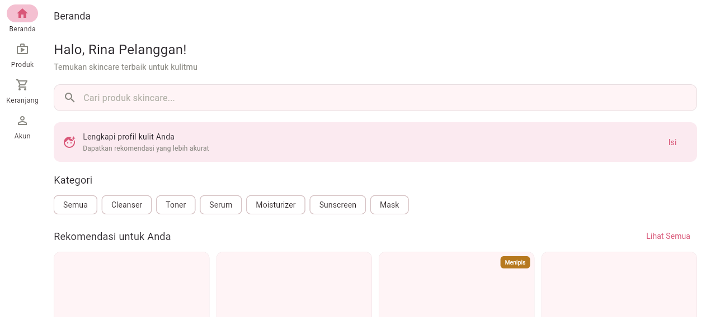

# SkinCare Store

Aplikasi toko skincare dengan pengingat PAO (Period After Opening) dan filter berdasarkan tipe kulit. Proyek individu MK Mobile and Web Application Development.

## Identitas

- **Nama:** Are Kusuma Pratiwi
- **NIM:** 23.01.55.0014
- **Kelas:** A1 / A2DLC
- **Mata Kuliah:** Mobile and Web Application Development
- **Semester:** Ganjil 2026/2027

## Deskripsi Singkat

SkinCare Store membantu pengguna menemukan produk skincare yang cocok untuk tipe kulitnya. Pengguna dapat mengisi profil kulit (tipe kulit, concern, alergi), menjelajah katalog produk, memesan produk, dan memantau status pesanan. Setiap produk dilengkapi informasi kandungan aktif dan PAO. Tersedia pula dashboard admin untuk mengelola produk dan pesanan.

## Teknologi

- Flutter + Dart (dijalankan di Chrome / web)
- Provider (state management)
- GoRouter (navigasi)
- **Firebase Authentication 7.0.1 + firebase_core 5.1.0** (login Email/Password, Minggu 9 — paket Spark)
- **Cloud Firestore 7.1.0 + Security Rules** (Minggu 10, branch `minggu-10-firestore`)
- Material 3 (warna primer #D95778)
- Mode data simulasi tetap tersedia lewat `--dart-define=PAKAI_MOCK=true`

## Tautan

- Desain Figma: https://www.figma.com/design/qVTUEcTMfDeced9ggBp90d/-2301550014--%E2%80%93--SkinCareStore--%E2%80%93-Wireframe?node-id=0-1&t=fjQwAe677ezcqBnl-1
- Video Guideline Dosen: https://youtu.be/zX4AaqMxp5I
- Video UTS (lengkap 6:15): [`video/out/uts-skincare-store-final.mp4`](video/out/uts-skincare-store-final.mp4)
- Proposal UTS: [`docs/uts/proposal-uts-skincare-store.docx`](docs/uts/proposal-uts-skincare-store.docx)
- **Laporan Minggu 9 (Firebase Login)**: [`docs/minggu-09/README.md`](docs/minggu-09/README.md)
- **Laporan Minggu 10 (Cloud Firestore & Security Rules)**: [`docs/minggu-10/README.md`](docs/minggu-10/README.md)

## Video UTS

Video presentasi UTS berdurasi **6 menit 15 detik** (1920×1080, 30 fps, narasi
Bahasa Indonesia, subtitle `.srt`), berisi enam bagian sesuai brief:

| Waktu | Bagian |
|-------|--------|
| 0:00 | **Pembuka** — nama, NIM, kelas, judul aplikasi |
| 0:17 | **Masalah & pengguna** — 4 pain point, persona Rina + admin |
| 2:01 | **Kebutuhan & prioritas fitur** — 15 halaman, 5 fitur Must, yang di-exclude |
| 2:59 | **Rancangan** — user flow, sitemap, wireframe Figma → implementasi Flutter |
| 3:52 | **Demo prototype berjalan** — 6 halaman terhubung + form tervalidasi |
| 5:51 | **Rencana teknis & penutup** — tech stack, 5 collection Firestore |

Video dibangun dari dua sumber:

1. **Slide** — [Remotion](https://www.remotion.dev/) + TTS gratis (`edge-tts`,
   suara `id-ID-GadisNeural`), sumber di [`video/src`](video/src).
2. **Demo prototype** — rekaman aplikasi Flutter web yang benar-benar berjalan,
   dikendalikan [Playwright](https://playwright.dev/) (klik mouse dan ketikan
   keyboard sungguhan). Panduan lengkap:
   [`docs/uts/panduan-demo-prototype.md`](docs/uts/panduan-demo-prototype.md).

Cara render ulang: [`video/README.md`](video/README.md).

## Cara Menjalankan

```bash
flutter pub get
firebase deploy --only firestore:rules,firestore:indexes --project toko-skincare-fec17
python scripts/promote_admin.py        # sekali saja, menjadikan akun admin
flutter run -d chrome

# atau build statis:
flutter build web --release

# mode data simulasi (UTS / screenshot, tanpa Firestore):
flutter run -d chrome --dart-define=PAKAI_MOCK=true
```

> **Mulai Minggu 9 aplikasi wajib terhubung ke Firebase.** `main.dart` memanggil
> `await Firebase.initializeApp(options: DefaultFirebaseOptions.currentPlatform)`
> sebelum `runApp`. Konfigurasi ada di `lib/firebase_options.dart` dan hanya
> diset untuk platform **web** (target praktikum = Chrome).
>
> **Branch:** pekerjaan Minggu 10 ada di `minggu-10-firestore`. Branch `main`
> sengaja dibiarkan pada kondisi Minggu 9 agar penilaian UTS tidak tercampur.
> Untuk UTS, data simulasi masih diperbolehkan oleh brief.

Akun simulasi (tersimpan sungguhan di Firebase Authentication, **bukan** lagi
data di memori; password ini sengaja bukan password asli):

| Peran | Email | Password |
|-------|-------|----------|
| Admin | admin@skincare.id | 123456 |
| Pelanggan | rina@mail.com | 123456 |

Akun baru juga bisa dibuat langsung lewat tombol **Daftar** pada halaman Masuk.

## Minggu 9 — Firebase Authentication

Project Firebase `toko-skincare-fec17` (paket **Spark**, tanpa billing) sudah
terhubung. Hanya penyedia **Email/Password** yang diaktifkan. Bagian ini
mendokumentasikan kondisi **Minggu 9**; Firestore ditambahkan pada Minggu 10
(lihat bagian berikutnya).

| Yang berjalan | Ringkasan |
|---|---|
| Satu halaman dua mode | `lib/screens/auth/masuk_daftar_page.dart` (`_modeDaftar`) — Masuk & Daftar, form tervalidasi, `obscureText`, tombol nonaktif saat proses |
| Auth gate | `StreamBuilder<User?>` pada `authStateChanges()` + `GoRouterRefreshStream` → redirect otomatis, tanpa `Navigator` |
| Halaman publik | Hanya `/login` dan `/register`; 13 halaman lain tertutup bagi yang belum masuk |
| Sesi | Bertahan setelah refresh browser; tombol **Keluar** di app bar Beranda & Dashboard Admin |
| Pesan kesalahan | 10 kode `FirebaseAuthException` diterjemahkan ke Bahasa Indonesia; kode kredensial disamakan agar tidak membocorkan email terdaftar |

**Verifikasi**: `flutter analyze` 0 error/0 warning · `flutter test` 13 lulus ·
`flutter build web --release` berhasil · **9 kasus uji integrasi di Chrome: 9 SESUI**.

Dokumentasi lengkap: [tabel uji 9 kasus](docs/minggu-09/tabel-uji-login.md),
[setup Firebase](docs/minggu-09/setup-firebase.md),
[refleksi](docs/minggu-09/refleksi.md),
[daftar periksa](docs/minggu-09/daftar-periksa.md),
[bukti screenshot](docs/minggu-09/bukti/).

Untuk mengulang uji login otomatis:

```bash
cd build/web && python -m http.server 8137 --bind 127.0.0.1
# terminal lain:
cd video && node scripts/uji-login-m9.js
```

## Minggu 10 — Cloud Firestore & Security Rules

Branch `minggu-10-firestore` mengganti `MockDataSource` dengan
`FirestoreDataSource` untuk **5 collection**: `users`, `products`,
`skin_profiles`, `orders`, `carts`. Peran admin kini dibaca dari dokumen
`users/{uid}`, bukan lagi email hard-code.

| Yang berjalan | Ringkasan |
|---|---|
| Arsitektur | Cache lokal + listener `snapshots()` realtime + optimistic write — **15 halaman UI tidak diubah** |
| Dependency injection | `lib/data/app_repositories.dart` → `firestore()` / `mock()` / `custom()`; `DataSync` menyegarkan semua Provider |
| Keamanan | [`firestore.rules`](firestore.rules): default-deny, wajib login, isolasi per `uid`, validasi bentuk dokumen, `role` hanya bisa diubah admin |
| Admin | `python scripts/promote_admin.py` menaikkan peran lewat kredensial pemilik project (klien tidak bisa mengangkat diri sendiri) |
| Seed | Login admin pertama mengisi 10 produk contoh bila `products` kosong |
| Mode simulasi | `--dart-define=PAKAI_MOCK=true` tetap tersedia untuk UTS |

**Verifikasi**: `flutter analyze` 0 error/0 warning · `flutter test` **24/24** ·
`flutter build web --release` berhasil · **uji Rules 13/13 SESUI** ·
**uji integrasi Chrome 8/8 SESUI** (termasuk keranjang tetap ada setelah refresh).

Dokumentasi lengkap: [README Minggu 10](docs/minggu-10/README.md),
[setup Firestore](docs/minggu-10/setup-firestore.md),
[struktur database](docs/minggu-10/struktur-database.md),
[keputusan keamanan](docs/minggu-10/keputusan-keamanan.md),
[perubahan kode](docs/minggu-10/perubahan-kode.md),
[tabel uji](docs/minggu-10/tabel-uji.md),
[refleksi](docs/minggu-10/refleksi.md),
[daftar periksa](docs/minggu-10/daftar-periksa.md),
[bukti](docs/minggu-10/bukti/).

## Screenshot

### Beranda



### Form Checkout dengan Validasi


## Struktur Project

```
lib/
├── core/           # Theme, constants, utils (validators, validasi_auth)
├── data/           # Models, repositories, data sources (mock + firestore), app_repositories.dart
├── providers/      # State management (Provider) — disuntikkan dari AppRepositories
├── screens/        # UI (auth, customer, admin)
│   └── auth/       # masuk_daftar_page.dart, cek_status_login.dart
├── widgets/        # Reusable widgets
├── router/         # GoRouter + go_router_refresh_stream.dart
├── firebase_options.dart  # DefaultFirebaseOptions.currentPlatform (web)
└── main.dart              # Firebase.initializeApp + AppRepositories + MultiProvider

(root project)
├── firestore.rules        # Aturan keamanan Firestore
├── firestore.indexes.json # Daftar index (kosong)
├── firebase.json          # Konfigurasi FlutterFire + referensi rules
└── scripts/               # promote_admin.py, uji_rules.py, verifikasi_data.py
```

### Halaman yang Dibangun (15 halaman)

**Pelanggan (11 halaman):**
- Login, Register
- Beranda, Daftar Produk, Detail Produk
- Keranjang, Checkout, Status Pesanan, Riwayat Pesanan
- Profil Kulit, Akun

**Admin (4 halaman):**
- Dashboard Admin, Kelola Produk, Form Produk, Kelola Pesanan

### Navigasi

- **Mobile (<600px)**: Bottom NavigationBar (Beranda, Produk, Keranjang, Akun)
- **Web (>=600px)**: NavigationRail sidebar (responsive)

### Form & Validasi

- **Masuk / Daftar** (satu halaman dua mode, Minggu 9): email + password (format email, minimal 6 karakter); mode Daftar menambah nama lengkap dan ulangi password. Pesan kesalahan Firebase tampil sebagai banner merah yang menetap.
- **Checkout**: nama penerima, telepon, alamat (validasi wajib, format angka, minimal 10 karakter)
- **Profil Kulit**: tipe kulit (ChoiceChip), concern (FilterChip), alergi (text)
- **Form Produk**: nama, kategori (dropdown), harga, stok (angka), kandungan aktif, tipe kulit cocok, PAO (dropdown), manfaat, cara pakai

Semua form menggunakan:
- `GlobalKey<FormState>` untuk validasi
- `autovalidateMode: AutovalidateMode.onUserInteraction`
- Pesan kesalahan spesifik di dekat kolom
- `SnackBar` untuk pesan status berhasil/gagal
- `hideCurrentSnackBar()` sebelum menampilkan SnackBar baru

## Status Pengembangan

- [x] Fase 1 — Layar inti pelanggan (Login, Beranda, Daftar Produk, Detail Produk, Keranjang, Checkout, Status Pesanan)
- [x] Fase 2 — Layar pelengkap (Register, Akun, Profil Kulit, Riwayat Pesanan)
- [x] Fase 3 — Layar admin (Dashboard, Kelola Produk, Form Produk, Kelola Pesanan)
- [x] Fase 4 — Responsive web (bottom nav mobile ↔ sidebar web)
- [x] Fase 5 — Form validasi & state sederhana (Minggu 7)
- [x] Fase 6a — **Firebase Authentication** (Minggu 9): daftar/masuk/keluar, auth gate, sesi, pesan kesalahan
- [x] Fase 6b — **Cloud Firestore** (Minggu 10, branch `minggu-10-firestore`): 5 collection `users`, `products`, `skin_profiles`, `orders`, `carts` + Security Rules aman
